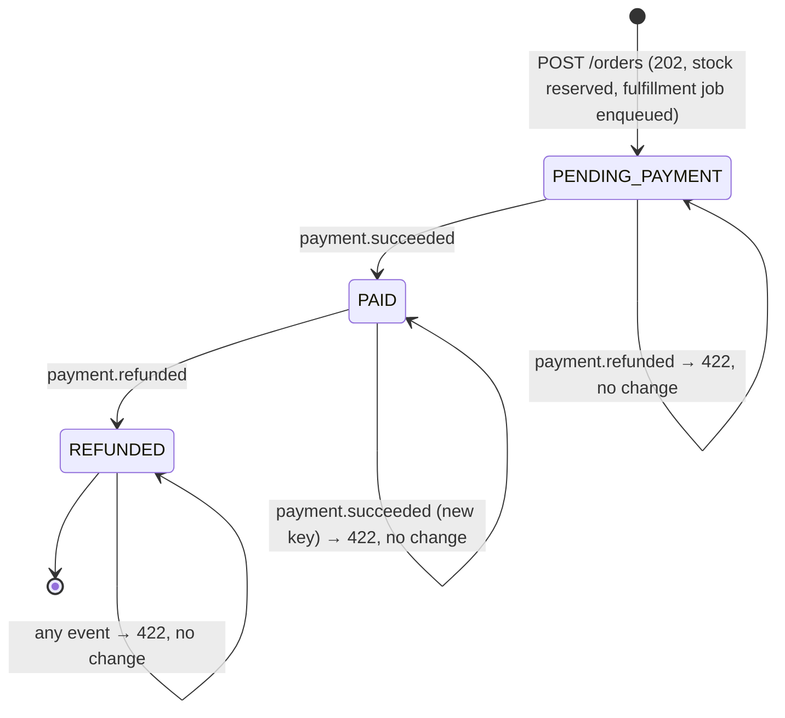
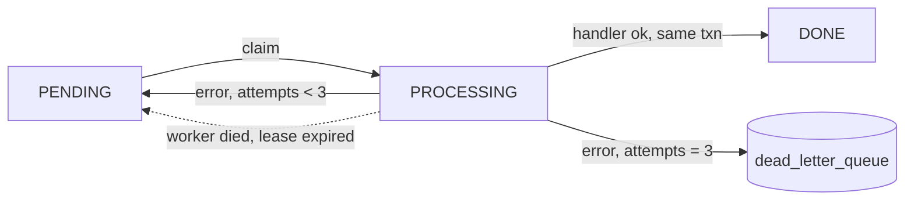

# async-webhook-state-machine-qa

A small order service plus the test harness that tries to break it. The service sells stock, takes signed payment webhooks, and runs a background fulfillment worker. The tests check the failures that usually show up in production: overselling under load, double charges from webhook retries, events arriving out of order, poison messages that stall a queue, and forged or replayed webhooks.

Everything runs in a single Python process, so you don't need Docker, Redis, RabbitMQ or Celery. The job queue and dead-letter queue are SQLite tables, processed by an `asyncio` worker.

## What this demonstrates

| Skill | Where |
|---|---|
| Optimistic concurrency control (`version` column, conditional `UPDATE`) | `sut/state_machine.py` |
| Strict state machine with illegal-transition rejection | `sut/state_machine.py` |
| Idempotency keys for API requests and webhook events | `sut/app.py`, `PaymentLedger` |
| DB-backed queue with retries, backoff, lease recovery, DLQ | `sut/worker.py` |
| HMAC-SHA256 webhook auth with a 5-minute replay window | `sut/app.py` |
| Deterministic async tests: no fixed sleeps, `wait_until()` polling with diagnostics | `tests/helpers/polling.py` |
| Same suite runs in-process or against a deployed URL | `tests/conftest.py` |
| CI with an HTML report artifact | `.github/workflows/test-suite.yml` |

## Order state machine



Every accepted transition increments `orders.version`. A replay of an event that was already processed, with the same `Idempotency-Key` and body, returns `200` with `"result": "duplicate"` and changes nothing.

## Job lifecycle



## API

| Method | Path | Notes |
|---|---|---|
| `POST` | `/orders` | Header `Idempotency-Key` required. `202` created or replayed, `409 OUT_OF_STOCK`, `409 IDEMPOTENCY_KEY_REUSED`, `404` unknown product. |
| `GET` | `/orders/{id}` | Status, version, fulfillment status. |
| `POST` | `/webhooks/payment` | Headers `X-Timestamp`, `X-Signature` = hex HMAC-SHA256 of `f"{timestamp}.{raw_body}"`, `Idempotency-Key`. `401` bad or expired auth, `400` missing key, `422` invalid body or illegal transition, `200` processed or duplicate. |
| `GET` | `/health` | Liveness and worker status. |
| various | `/_test/*` | Seeding and inspection for black-box tests. Only mounted when `ENABLE_TEST_ENDPOINTS=1`. |

## Run it locally

Requires Python 3.11 or newer.

```bash
python3 -m venv .venv
source .venv/bin/activate
pip install -e ".[test]"

pytest                                            # in-process, isolated SQLite file per test
pytest --html=report.html --self-contained-html   # plus a shareable HTML report
pytest tests/suites/test_race_conditions.py -v    # one suite
```

In local mode, each test gets a fresh SQLite database in its own temp directory, an in-process app driven through `httpx.ASGITransport`, and, if the test asks for it, its own background worker. No state is shared between tests, so the order they run in doesn't matter.

## Run it against a deployed service (remote mode)

Start the SUT, or point at any deployment, with the test endpoints enabled and a known secret:

```bash
DATABASE_URL="sqlite+aiosqlite:///./remote.db" \
WEBHOOK_SECRET=whsec_shared_secret \
ENABLE_TEST_ENDPOINTS=1 \
uvicorn sut.app:create_app --factory --port 8000
```

Then run the same suites over HTTP:

```bash
BASE_URL=http://127.0.0.1:8000 WEBHOOK_SECRET=whsec_shared_secret pytest
```

Tests marked `local_only`, which read database tables directly, are skipped in this mode. Everything else checks behavior through the HTTP API only.

## Failure-mode coverage matrix

| Failure mode | What could go wrong in production | Expected behavior | Test file |
|---|---|---|---|
| Last-unit race | 25 buyers, 1 unit, everyone gets charged | Exactly 1 × `202`, 24 × `409 OUT_OF_STOCK`, stock `0`, version bumped once | `test_race_conditions.py` |
| Oversell at higher stock | Stock goes negative under load | Winners = stock, losers get `409`, stock `0` | `test_race_conditions.py` |
| Orphaned rows on conflict | Losers leave half-created orders or jobs | 1 order row, 1 fulfillment job (`local_only`) | `test_race_conditions.py` |
| Webhook retry storm | Provider retries 15× in parallel and the customer is charged 15× | All `200`, 1 `processed` + 14 `duplicate`, 1 ledger row, 1 transition | `test_idempotency.py` |
| Late replay | Retry arrives after processing | `200 duplicate`, no side effects | `test_idempotency.py` |
| Key reuse with a different body | Client bug reuses a key | `409 IDEMPOTENCY_KEY_REUSED`, state unchanged | `test_idempotency.py` |
| Double-click order submit | Same order created twice | 10 concurrent same-key requests give 1 order, stock −1 | `test_idempotency.py` |
| Out-of-order events | Refund arrives before payment | `422 ILLEGAL_TRANSITION`, stays `PENDING_PAYMENT`, then payment gives `PAID` | `test_state_transitions.py` |
| Illegal re-entry | `PAID→PAID`, `REFUNDED→PAID`, `REFUNDED→REFUNDED` | `422`, version and ledger unchanged | `test_state_transitions.py` |
| Signed garbage | Valid signature, invalid body | `422 INVALID_PAYLOAD` | `test_state_transitions.py` |
| Poison message | One bad job blocks or crashes the worker | Job retried 3×, moved to DLQ with traceback and original payload, 5 healthy jobs complete, worker still running | `test_dlq_resilience.py` |
| Worker liveness after DLQ | Worker silently dies after a failure | New jobs are still processed | `test_dlq_resilience.py` |
| Tampered body | Attacker edits `amount_cents` | `401`, no state change, no ledger row | `test_webhook_security.py` |
| Forged signature | Wrong secret | `401` | `test_webhook_security.py` |
| Replay attack | Captured request resent after 5 min | `401` (expired, future, or old signature with fresh timestamp) | `test_webhook_security.py` |
| Missing or garbled auth headers | Unauthenticated calls | `401` | `test_webhook_security.py` |
| Window boundary | Legit event 290 s old | Accepted, `200` | `test_webhook_security.py` |

## Design notes

- **Why every transaction starts with `BEGIN IMMEDIATE`.** SQLite has a single writer. A transaction that reads first and writes later would otherwise fail with `SQLITE_BUSY` when it tries to upgrade its lock. Taking the write lock up front makes writers queue behind `busy_timeout` instead.
- **Optimistic locking is still needed.** Order creation reads the product in one short transaction and writes in another, like a real service that calls out between steps. The conditional `UPDATE ... WHERE version = :seen AND stock >= :qty` is what stops a stale reader from overselling. A conflict re-reads and retries; zero stock returns `409`.
- **Handler and `DONE` commit together.** A job's side effects and its completion mark commit in one transaction, so a crash can't leave work half-applied.
- **The signer is an independent oracle.** `tests/helpers/signer.py` re-implements the HMAC scheme instead of importing it from the SUT. If both sides shared one buggy function, the tests would pass anyway.
- **No fixed sleeps in tests.** Async outcomes are asserted with `wait_until(predicate, timeout, interval)`, which returns as soon as the condition holds. On timeout it reports the last value it saw and the last error.

## Limitations

- SQLite serializes writes, so this proves correctness under concurrency, not throughput. On Postgres the same conditional updates apply, and `SELECT ... FOR UPDATE SKIP LOCKED` would replace the claim query.
- Concurrency here comes from `asyncio.gather` within one process. Multi-process contention is only covered when running against a deployed server in remote mode.
- `/_test/*` endpoints are a test seam and must never be enabled in production.
- The webhook secret defaults are for local use only.

## Interview summary

"I built a FastAPI order service and an async pytest harness that proves it can't oversell when 25 orders race for 1 unit, charges once when a webhook is retried 15 times at once, rejects out-of-order and forged or replayed events, and moves poison jobs to a dead-letter queue without stalling the worker. It needs no infrastructure, uses no fixed sleeps, and the same suite runs in-process or against a deployed URL."
