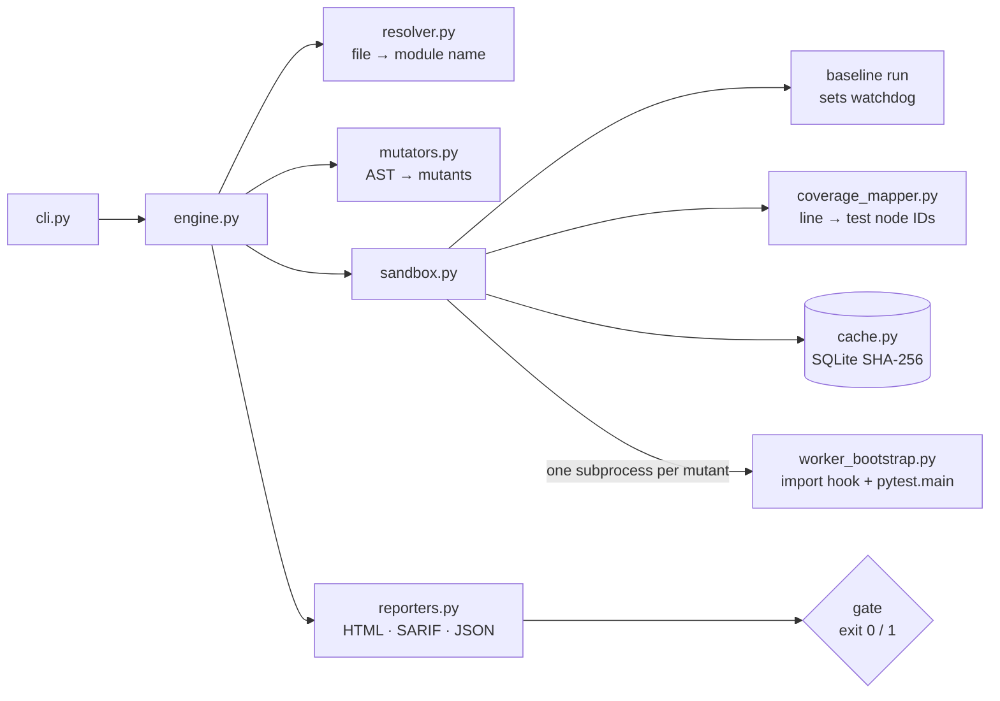

# pymutate-enterprise

[](https://github.com/alam-khawaja/sdet-engineering-journey/actions/workflows/pymutate-gate.yml)


A mutation testing engine for Python. It answers the question line coverage cannot: **if this code were wrong, would any test notice?**

pymutate makes one small, realistic bug at a time (a `>=` becomes `>`, an `and` becomes `or`, a guard clause is skipped), runs only the tests that execute that line, and records whether they fail. A test suite that still passes against a bug has a gap, and the report shows exactly where.

The bundled demo shows why coverage is not enough. Its tests have **100% line coverage**, but they kill only **65.48%** of mutants, and the CI gate rejects them.

## What it does

| Capability | How | Where |
|---|---|---|
| Zero-disk mutation | The mutated source is served from memory by an import hook at `sys.meta_path[0]`. Source files are never rewritten. | `pymutate/worker_bootstrap.py` |
| Cross-virtualenv execution | `--target-python /path/to/other/venv/bin/python` runs the worker inside the project's own environment. The worker needs only the stdlib and pytest. | `pymutate/sandbox.py` |
| Watchdog | `timeout = max(3.0, baseline × 3.0)`. A mutant that loops forever is killed and counted as detected (`TIMEOUT`). | `pymutate/sandbox.py` |
| Six risk-labelled mutators | Numeric boundary, comparison, boolean logic (MC/DC), boolean defaults, arithmetic, guard-clause bypass | `pymutate/mutators.py` |
| Noise filters | Skips docstrings, logging and `warnings.warn` calls, asserts, f-strings, `__repr__`/`__str__`, `TYPE_CHECKING` blocks, `__main__` guards, `@overload`, `@no_mutate`, and `# pragma: no mutate` | `pymutate/mutators.py` |
| Test targeting | Per-test coverage contexts map each source line to the pytest node IDs that run it, so each mutant runs only the relevant tests. | `pymutate/coverage_mapper.py` |
| Incremental cache | SQLite, keyed by SHA-256 of (file, line, mutated source, covering tests and a test-file fingerprint). Editing a test invalidates its entries. | `pymutate/cache.py` |
| Policy gate | Overall minimum score, plus stricter per-path thresholds for critical code | `[tool.pymutate]` in `pyproject.toml` |
| Diff-scoped runs | `--diff-base origin/main` mutates only lines changed in the PR. | `pymutate/engine.py` |
| Git time-machine benchmark | Proves the tool catches real regressions: the fix commit's tests must kill mutants that the parent commit's tests let survive. | `pymutate/benchmark.py` |
| Reports | Self-contained HTML with diffs and filters, SARIF 2.1.0 for GitHub code scanning, JSON, and a CLI summary | `pymutate/reporters.py` |

## Architecture



What happens to one mutant:

1. `mutators.py` parses the file and replaces exactly one node's source span. The line count is preserved, so tracebacks still point at the right lines. A mutant that does not compile is discarded.
2. `coverage_mapper.py` has already recorded which tests execute that line. A mutant on a line no test runs is `UNCOVERED`; it is never executed but still counts against the score.
3. The cache is checked. A hit replays the earlier verdict as `CACHED_KILLED` or `CACHED_SURVIVED`.
4. Otherwise `sandbox.py` writes a JSON payload and starts `<target-python> -B worker_bootstrap.py payload.json`. The worker installs the import hook, runs `pytest.main()` on the covering node IDs, and exits with pytest's code.
5. Each exit code maps to a verdict:

| Exit | Verdict |
|---|---|
| 0 | `SURVIVED` |
| 1–3, signal, other | `KILLED` |
| watchdog expiry | `TIMEOUT` (counts as killed) |
| 4, 5, 96 | worker error, reported as `SURVIVED` with a detail message so infrastructure problems never inflate the score |
| 97 | `SURVIVED`: tests passed but never imported the module |

**Kill score** = (KILLED + TIMEOUT + CACHED_KILLED) / all mutants. `UNCOVERED` stays in the denominator.

## Quickstart

```bash
cd projects/pymutate-enterprise
python -m venv .venv && source .venv/bin/activate
pip install -e .

pytest tests/ -q                 # pymutate's own self-test suite
python -m pymutate.cli run       # mutation gate on demo_sut/ (expected to FAIL, exit 1)
open mutation-report.html
```

Useful flags:

```bash
python -m pymutate.cli run --diff-base origin/main           # only lines changed vs main
python -m pymutate.cli run --target-python ../app/.venv/bin/python
python -m pymutate.cli run --mutators GuardClause BooleanLogic --min-score 90
python -m pymutate.cli run --no-cache --json mutation.json
python -m pymutate.cli cache --clear
```

CLI exit codes: `0` gate passed, `1` gate failed, `2` configuration or runtime error (including a failing baseline suite).

## Configuration

```toml
[tool.pymutate]
paths = ["demo_sut"]
tests = ["demo_tests"]
default_min_score = 80.0
path_thresholds = { "demo_sut/credit_underwriting.py" = 90.0 }
exclude = ["**/__init__.py"]
workers = 4
timeout_multiplier = 3.0
min_timeout_sec = 3.0
```

`path_thresholds` keys can be a file or a directory. The most specific match wins. Every file under an explicit threshold must meet it on its own, even if the overall score passes.

## The demo: coverage lies

`demo_sut/` contains a loan underwriting module and a tiered billing module with fraud checks, all synthetic. `demo_tests/` is deliberately weak: it runs every line and pins exact results for the logic paths, but never tests a value **at** a boundary (score 620, DTI 0.43, 100 units, velocity just under the limit).

Measured locally on Python 3.15, macOS:

| File | Line coverage | Mutants | Kill score | Threshold | Gate |
|---|---|---|---|---|---|
| `demo_sut/credit_underwriting.py` | 100% | 47 | 61.70% | 90% (explicit) | FAIL |
| `demo_sut/tiered_billing.py` | 100% | 37 | 70.27% | 80% (default) | — |
| **Overall** | **100%** | **84** | **65.48%** | 80% | **FAIL, exit 1** |

Typical survivors read like a review comment:

```
SURVIVED  demo_sut/credit_underwriting.py:84  [HIGH - BOUNDARY GAP] Replace `<` with `<=` in `applicant.credit_score < MIN_CREDIT_SCORE`
SURVIVED  demo_sut/tiered_billing.py:30       [HIGH - BOUNDARY GAP] Shift comparison boundary 1000 -> 999 in `units >= 1000`
```

The first means an applicant with a score of exactly 620 could be wrongly declined and no test would notice.

## CI and SARIF

The repository-root workflow [`.github/workflows/pymutate-gate.yml`](../../.github/workflows/pymutate-gate.yml) runs on Python 3.11 and 3.12. It:

1. installs the package,
2. requires the self-test suite to be 100% green,
3. runs the gate on the demo and **requires exit code 1** (the weak suite must be caught),
4. rewrites SARIF paths to be relative to the repository root,
5. uploads the HTML and SARIF reports as artifacts and publishes the SARIF to code scanning.

Survivors then appear as code-scanning alerts on the exact line. Each alert's `partialFingerprints.pymutateMutantId/v1` is stable across runs, so GitHub tracks one alert per mutant instead of reopening duplicates.

To use pymutate as a real gate in another repository, remove the "expect exit 1" inversion and let a non-zero exit fail the job. The project-level copy in `.github/workflows/mutation-gate.yml` is that template for use when this project lives in its own repository.

## Benchmarking against real projects

The time-machine benchmark validates the tool on a real bug fix:

```bash
git clone https://github.com/pypa/packaging && cd packaging
pip install -e . pytest coverage
python -m pymutate.cli benchmark --repo . --commit <fix-sha> --paths src/packaging --tests tests
```

For the chosen commit it:

1. checks out the fix and mutates only the lines the fix changed,
2. runs the fix commit's tests (post-fix run),
3. rolls the test paths back to the parent commit and deletes test files the fix added,
4. runs again (pre-fix run),
5. restores the original branch with `checkout --force`, even on failure.

The verdict is `VALIDATED` (exit 0) when at least one mutant is killed post-fix but survives pre-fix. In other words, pymutate would have flagged the missing test before the bug shipped. The tree must be clean before it starts.

### Results on real open-source projects

All runs were done locally on 2026-11-24 on macOS, against fresh clones:

- [pypa/packaging](https://github.com/pypa/packaging): `main` at `8fb1b46`.
- [encode/httpx](https://github.com/encode/httpx): `master` at `7cff5f7`.
- [dateutil/dateutil](https://github.com/dateutil/dateutil): `master` at `261e291`.

pymutate itself ran on Python 3.15.1. Each project was installed in editable mode in its own venv and passed with `--target-python`.

- **packaging and dateutil** ran on Python 3.15.1 (pytest 9.2.0, coverage 7.17.5).
- **httpx** ran on **Python 3.9.6** (pytest 7.2.2, coverage 7.10.7). Its April 2023 fix needs `httpcore<0.18`, which does not import on Python 3.15. That run doubles as a real-world check of the cross-virtualenv worker.

| Project | Fix commit | Change | Tests used | Mutants on changed lines | Pre-fix → post-fix kill score | Verdict |
|---|---|---|---|---|---|---|
| packaging | [`71de7cb`](https://github.com/pypa/packaging/commit/71de7cb) | pylock rejects `2.0` prereleases: `< Version("2")` became `< Version("2.dev0")` | `tests/test_pylock.py` | 3 | 66.67% → 100% | **VALIDATED** (6 s) |
| packaging | [`4d7875f`](https://github.com/pypa/packaging/commit/4d7875f) | Markers nested deeper than 200 raise `InvalidMarker` | full `tests/` (~7,900 tests) | 2 | 0% → 100% | **VALIDATED** (~11 min) |
| packaging | [`55cbf1b`](https://github.com/pypa/packaging/commit/55cbf1b) | `if version is None: inclusive = False` | full `tests/` | 0 | — | NOT VALIDATED (no mutants) |
| httpx | [`15d09a3`](https://github.com/encode/httpx/commit/15d09a3) | `NO_PROXY` supports IPv4, IPv6 and `localhost` | `tests/test_utils.py` | 1 | 0% → 100% | **VALIDATED** (8 s) |
| dateutil | [`d23ff76`](https://github.com/dateutil/dateutil/commit/d23ff76) | `relativedelta(yearday=366)` no longer resolves to Dec 30 in leap years | `tests/test_relativedelta.py` | 6 | 0% → 66.67% | **VALIDATED** (10 s) |
| dateutil | [`99f6653`](https://github.com/dateutil/dateutil/commit/99f6653) | Correct dates for day-of-year rules in TZ strings | `tests/test_tzfile.py` | 17 | 94.12% → 100% | **VALIDATED** (49 s) |
| dateutil | [`2283058`](https://github.com/dateutil/dateutil/commit/2283058) | `dst()` for zones that end in permanent DST | `tests/test_tzfile.py` | — | — | ERROR (exit 2): pre-fix baseline fails |

Raw `--json` output for each completed run is in [`benchmarks/`](benchmarks/).

Fix-detected mutants, meaning they survived (or were never reached by) the parent commit's tests and were killed by the fix commit's tests:

```
packaging 71de7cb  src/packaging/pylock.py:611        [HIGH - BOUNDARY GAP]      Replace `<` with `<=` in `Version('1') <= pylock.lock_version < Version('2.dev0')`
packaging 4d7875f  src/packaging/_parser.py:395       [HIGH - BOUNDARY GAP]      Replace `>=` with `>` in `depth >= _MAX_MARKER_NESTING`
packaging 4d7875f  src/packaging/_parser.py:407       [MEDIUM - CALCULATION BUG] Replace `+` with `-` in `depth + 1`
httpx     15d09a3  httpx/_utils.py:269                [HIGH - BOUNDARY GAP]      Replace `==` with `!=` in `hostname.lower() == 'localhost'`   (UNCOVERED -> KILLED)
dateutil  d23ff76  src/dateutil/relativedelta.py:215  [HIGH - BOUNDARY GAP]      Replace `<` with `<=` in `59 < yearday < 366`
dateutil  d23ff76  src/dateutil/relativedelta.py:215  [HIGH - BOUNDARY GAP]      Shift comparison boundary 366 -> 367 in `59 < yearday < 366`
dateutil  d23ff76  src/dateutil/relativedelta.py:215  [HIGH - BOUNDARY GAP]      Shift comparison boundary 366 -> 365 in `59 < yearday < 366`
dateutil  d23ff76  src/dateutil/relativedelta.py:215  [HIGH - BOUNDARY GAP]      Shift comparison boundary 59 -> 60 in `59 < yearday < 366`
dateutil  99f6653  src/dateutil/tz/_tzfile.py:1269    [HIGH - BOUNDARY GAP]      Shift comparison boundary 59 -> 58 in `d >= 59`
```

What the runs show:

- **packaging `71de7cb`:** the fix added `"2.0.dev0"` to the unsupported-version test cases. That is exactly the input that tells `<` from `<=`, and the parent's tests had no such case.
- **httpx `15d09a3`:** the parent's tests never executed the new `localhost` branch at all. The mutant was `UNCOVERED` before and `KILLED` after.
- **dateutil `d23ff76`:** the fix itself is a boundary (`59 < yearday < 366`), and the parent's tests could not tell any of its boundary mutants apart. Two `<`-side mutants still survive the fix's tests, which is why the post-fix score is 66.67%. That is a remaining gap in dateutil's own tests, not a pymutate failure.
- In every case, pymutate would have pointed at the missing test before the bug shipped.

The two non-validated rows are real limits, and they are reported rather than hidden:

- **packaging `55cbf1b`:** the changed lines contain an `is None` check guarding an assignment. pymutate does not mutate `is`/`is not`, and it only bypasses guards whose body ends in `return` or `raise`. Result: no mutants, NOT VALIDATED (exit 1).
- **dateutil `2283058`:** the fix *changed the expected values* of existing tests in `tests/test_tzfile.py`. After rolling the tests back, the parent's tests assert the old buggy behaviour, so they fail against the fixed source. pymutate refuses to judge mutants against a red baseline and exits 2. The time-machine method only works when a fix adds or tightens tests rather than rewriting existing expectations.

These seven commits are a small sample. They were picked by hand from "fix" commits whose changed lines contain comparisons, arithmetic, or guards, so they prove the mechanism works on real projects; they are not a detection-rate statistic. Most of the 4d7875f run is two baseline runs of the full suite; `--tests` scoping is the practical mode. The self-test suite also proves the mechanism on a synthetic repository (`TestBenchmark` in `tests/test_sandbox_and_engine.py`).

## Self-test suite

137 tests, all passing locally in about 32 seconds:

| File | Covers |
|---|---|
| `tests/test_mutators.py` | Each mutator's exact output, every noise filter, line-count preservation, multi-line padding, stable IDs, diffs, `changed_lines` |
| `tests/test_resolver_and_cache.py` | Flat, package, and `src/` layouts and their errors; config validation; cache hit/miss/persistence/invalidation; score and gate rules |
| `tests/test_sandbox_and_engine.py` | The real worker subprocess (in-memory injection with the disk untouched, exit codes 0/1/96/97); infinite-loop timeout; cache replay; per-line coverage map; full engine runs; HTML/SARIF; CLI exit codes 0/1/2; git benchmark on a throwaway repository |

Engine tests build a throwaway `toyshop` project under `tmp_path`, so they never depend on the demo or the working tree.

## Limitations

- **Equivalent mutants** (changes that cannot alter behaviour) count as survivors. Use `# pragma: no mutate` on such lines.
- Identity and membership checks (`is`, `is not`, `in`) are not mutated, and guard bypass only applies to guards that `return` or `raise`. Fixes like packaging `55cbf1b` therefore produce no mutants.
- The time-machine benchmark needs the parent commit's tests to pass against the fixed source. Fixes that rewrite existing test expectations, like dateutil `2283058`, stop at the pre-fix baseline with exit 2.
- One subprocess per mutant gives strong isolation but costs pytest's startup time per mutant. Large suites should use `--diff-base` in PRs and run the full gate nightly.
- Only pure-Python modules loaded through the normal import system are mutated. C extensions and code run via `exec()` are not.
- Per-test coverage uses coverage.py's `ctrace` core. With the `sysmon` core (coverage.py's default on recent Pythons; observed here on 3.15), only the first test to hit a line was recorded, which under-reports covering tests.
- `pytest-xdist` is not used inside workers; parallelism is across mutants.
- The demo modules are synthetic. They do not represent any real lending or billing system.
